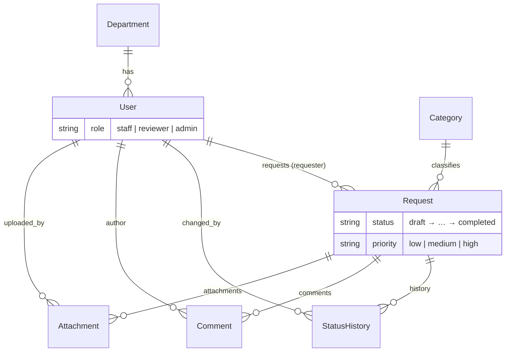

# 1. Architecture

## The system in one paragraph

Staff create **requests** (equipment, leave, documents, repairs). A request starts as a **draft** that only its requester sees. Once **submitted**, reviewers from the requester's department can **start review**, then **approve** or **reject** it (rejecting needs remarks). An admin **completes** approved requests. Every status change is written to an audit trail (**StatusHistory**). People who can see a request can comment on it; the requester can attach files while it is a draft. Admins manage users, departments, and categories.

## Two applications, one repository

```
request-tracker/
├── backend/        Django + Django REST Framework (the API, all business rules)
├── frontend/       Angular + PrimeNG (the UI; it only calls the API)
├── docs/           this handbook + openapi.yaml
├── CLAUDE.md       rules and context for Claude Code
└── README.md       setup instructions
```

The backend is the **single source of truth** for rules. The frontend mirrors some rules (for example hiding a button or checking a file size) only to give faster feedback; the server always re-checks. If the two ever disagree, the server wins and the UI shows the server's message.

| Concern | Backend | Frontend |
|---|---|---|
| Who may see what | `services.scoped_requests()` | nothing (it shows what the API returns) |
| Who may do what | `services.py` rules + permission classes | hides buttons using `available_actions`, `can_delete` |
| Validation | serializers + `validators.py` + services | form validators for instant feedback |
| Display | none | components, PrimeNG |

## How one click travels through the system

Example: a reviewer clicks **Approve** on `/requests/42`.

```mermaid
sequenceDiagram
    participant U as Browser (Angular)
    participant EI as errorInterceptor
    participant AI as authInterceptor
    participant D as Django / DRF
    participant S as services.py
    participant DB as MySQL

    U->>U: RequestDetail.onAction('approve') → ConfirmDialog → accept
    U->>EI: RequestsService.approve(42) (HttpClient POST)
    EI->>AI: pass through
    AI->>D: POST /api/v1/requests/42/approve/ + Authorization: Bearer <access>
    D->>D: JWTAuthentication → user
    D->>D: ApiUserRateThrottle (429 if over the rate)
    D->>D: RequestViewSet.approve → get_object() on scoped queryset (404 if not visible)
    D->>S: perform_transition(request, user, "approve", remarks)
    S->>DB: BEGIN; SELECT ... FOR UPDATE (lock the row)
    S->>S: permission check (403) → state check (400)
    S->>DB: UPDATE status; INSERT status_history; COMMIT
    S-->>D: updated request
    D-->>AI: 200 + RequestDetailSerializer (incl. available_actions)
    AI-->>EI: response (on 401: refresh token once, retry)
    EI-->>U: response (on 0/403/429/5xx: global toast)
    U->>U: toast "Request approved", reload request + history
```

Read the diagram top to bottom once; most features in this project follow exactly this path.

## Backend layers (inside one Django app)

```
urls.py          → which URL goes to which view (router for viewsets)
views.py         → thin: parse input, call a service, serialize output
permissions.py   → "may this user call this at all?" (delegates to services)
serializers.py   → input validation + output shape (JSON ↔ Python)
services.py      → business rules: scoping, workflow, uploads, counts
validators.py    → reusable checks (files)
filters.py       → query-string filtering and ordering
models.py        → tables, fields, relations, indexes
admin.py         → Django admin screens
signals.py       → side effects on model events (deleting files)
tests/           → API and service tests
```

Laravel mapping: `urls.py` ≈ `routes/api.php`, viewset ≈ resource controller, serializer ≈ Form Request + API Resource, `services.py` ≈ a Service class, permission class ≈ Policy/Gate, model ≈ Eloquent model, migration ≈ migration (but generated from the model).

**Rule of thumb:** if you are writing an `if` about roles, ownership, or status, it belongs in `services.py`, not in a view or serializer.

## Frontend layers

```
src/app/
├── app.config.ts       providers: router, HttpClient + interceptors, PrimeNG theme, toasts, title strategy
├── app.routes.ts       top-level routes; features are lazy-loaded
├── core/               singletons used everywhere: auth service, guards, interceptors, title strategy
├── shared/             reusable, feature-agnostic: components, pipes, models, utils, constants
├── layouts/            the page frame (toolbar, menu drawer, router outlet)
└── features/           one folder per business area: auth, dashboard, requests, admin, errors
    └── <feature>/
        ├── routes.ts   the feature's child routes (lazy-loaded)
        ├── models/     TypeScript interfaces for API shapes
        ├── services/   HttpClient calls (no UI)
        ├── pages/      routed components
        └── components/ child components used by the pages
```

Vue mapping: `app.config.ts` ≈ `main.ts` with `app.use(...)`, a feature `routes.ts` ≈ a route module with `component: () => import(...)`, a service with `providedIn: 'root'` ≈ a composable or Pinia store, an interceptor ≈ an axios interceptor, a guard ≈ `router.beforeEach`.

**Rules:**
- A feature never imports from another feature. If two features need something, it moves to `shared/` (that is why `Category` lives in `shared/models/category.model.ts`).
- Components never call `HttpClient` directly; services do.
- No hard-coded API URLs: services build URLs from `environment.apiUrl`.

## API conventions

- Everything under `/api/v1/`, plural nouns, trailing slashes (`/requests/42/`).
- Lists are paginated: `{count, next, previous, results}` (10 per page). Small lookup lists (categories, departments, comments, attachments, history) are not paginated.
- Every error has one shape: `{"detail": "human message", "errors": {"field": ["message"]}}`.
- Workflow actions are `POST /requests/{id}/<action>/` with an optional `{"remarks": ""}` body; URL segments are kebab-case (`start-review`), action names in JSON are snake_case (`start_review`).
- Ids that the user may not see return **404** (not 403), so the API never confirms that a record exists.

The full contract is in [openapi.yaml](openapi.yaml); in development Swagger UI runs at <http://localhost:8000/api/v1/docs/>.

## Data model



Delete rules (`on_delete`):
- `PROTECT`: a `Category` or `User` cannot be deleted while requests (or history, comments, attachments) point at it. The API turns this into a friendly 400 ("Deactivate it instead"); users are never deleted at all, only deactivated.
- `CASCADE`: history, comments, and attachments disappear together with their request (only drafts can be deleted).
- `SET_NULL`: deleting a department would clear `user.department`, but `accounts.services.delete_department` refuses while users are still assigned.

## Environments

| | Development | Production (Phase 7) |
|---|---|---|
| Django settings | `config.settings.dev` (set in `manage.py`, `wsgi.py`, `asgi.py`) | `config.settings.prod` |
| Secrets | `backend/.env` (never committed) | environment variables on the server |
| API URL in Angular | `environment.development.ts` → `http://localhost:8000/api/v1` | `environment.ts` → `/api/v1` (same domain) |
| CORS | `http://localhost:4200` allowed | not needed when served from one domain |
| Swagger UI | on | off (404) |
