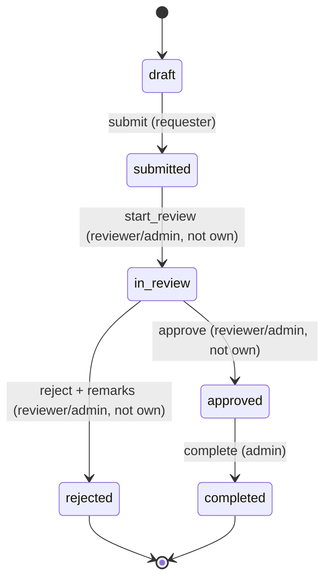

# 2. Backend (Django + DRF)

Every section answers: what it does, where it lives, why it is built this way, the Laravel equivalent, and pitfalls. Paths are relative to `backend/`.

**Contents:** [Settings](#21-settings) · [Apps](#22-apps) · [Custom user](#23-custom-user-and-timestampedmodel) · [Models and migrations](#24-models-and-migrations) · [Serializers](#25-serializers) · [Viewsets and routing](#26-viewsets-routers-and-custom-actions) · [Services layer](#27-the-services-layer) · [Authorization](#28-authorization-permissions-and-queryset-scoping) · [Filtering and pagination](#29-filtering-search-ordering-pagination) · [Avoiding N+1](#210-avoiding-n1-queries) · [Workflow](#211-the-request-workflow-state-machine) · [Comments](#212-comments) · [Attachments](#213-attachments-file-uploads) · [Dashboard](#214-dashboard-summary) · [User admin API](#215-user-and-department-administration) · [Errors](#216-one-error-shape) · [Throttling](#217-throttling) · [Logging](#218-logging) · [OpenAPI](#219-openapi-and-swagger-ui) · [Django admin](#220-django-admin-site) · [Seed command](#221-seed_demo_data) · [JWT settings](#222-jwt-settings)

---

## 2.1 Settings

**Where:** `config/settings/base.py`, `dev.py`, `prod.py`; `.env` / `.env.example`.

`base.py` holds everything shared. `dev.py` and `prod.py` start with `from .base import *` and override what differs:

| | `dev.py` | `prod.py` (stub until Phase 7) |
|---|---|---|
| `DEBUG` | `True` | `False` |
| `ALLOWED_HOSTS` | `localhost`, `127.0.0.1` | from env `ALLOWED_HOSTS` |
| `CORS_ALLOWED_ORIGINS` | `http://localhost:4200` | from env (usually empty: same domain) |
| HTTPS / HSTS / secure cookies | — | TODO comments for Phase 7 |

`manage.py`, `wsgi.py`, and `asgi.py` default `DJANGO_SETTINGS_MODULE` to `config.settings.dev`. A server overrides it with an environment variable.

Secrets and per-machine values come from `.env` through **django-environ** (`env("SECRET_KEY")`, `env.bool("DEBUG")`, `env.list(...)`). Database settings are separate variables (`DB_NAME`, `DB_USER`, ...) instead of one `DATABASE_URL`, so special characters in passwords need no escaping.

Because the settings now live one folder deeper, `BASE_DIR = Path(__file__).resolve().parent.parent.parent` (three parents) still points at `backend/`.

App-specific constants also live in settings so they are configurable and testable: `ATTACHMENT_MAX_BYTES`, `ATTACHMENT_MAX_PER_REQUEST`, `ATTACHMENT_ALLOWED_EXTENSIONS`, `LOGIN_THROTTLE_RATE`, `API_USER_THROTTLE_RATE`, `LOG_LEVEL`.

> **Laravel:** `config/*.php` reading `env()`, with `.env` per environment. Django has no per-environment `.env` switching; you pick a settings module instead.

**Pitfall:** `dev.py` lowers app log levels while `manage.py test` runs (`if "test" in sys.argv`) so test output stays readable.

## 2.2 Apps

**Where:** `apps/accounts`, `apps/core`, `apps/service_requests`; registered in `INSTALLED_APPS`.

An app is a self-contained module (models, views, admin, migrations, tests). Apps were created with `python manage.py startapp <name> apps/<name>` into an existing folder, so each `apps.py` needs `name = "apps.<name>"`. The **label** (used in `AUTH_USER_MODEL = "accounts.User"` and table names like `accounts_user`) is still the last part, `accounts`.

| App | Owns |
|---|---|
| `core` | `TimeStampedModel`, health endpoint, JSON 404/500 views, exception handler, throttles, `debug_only` |
| `accounts` | `User`, `Department`, login/refresh/`/me/`, user and department admin API |
| `service_requests` | categories, requests, workflow, history, comments, attachments, dashboard |

It is called `service_requests`, not `requests`, so it never shadows the popular `requests` HTTP library.

`ServiceRequestsConfig.ready()` imports `signals.py`; that is the standard place to connect signal receivers.

> **Laravel:** roughly a module or package with its own service provider (`ready()` ≈ `boot()`).

## 2.3 Custom user and TimeStampedModel

**Where:** `apps/accounts/models.py`, `apps/core/models.py`.

```python
class User(AbstractUser):
    class Role(models.TextChoices):
        STAFF = "staff", "Staff"; REVIEWER = "reviewer", "Reviewer"; ADMIN = "admin", "Admin"
    role = models.CharField(max_length=20, choices=Role.choices, default=Role.STAFF)
    department = models.ForeignKey(Department, null=True, blank=True, on_delete=models.SET_NULL, related_name="users")
```

`AUTH_USER_MODEL = "accounts.User"` was set **before the first `migrate`**. Changing the user model after tables exist is painful (the auth tables and every foreign key to the user would need rebuilding), so even if you need no extra fields, start every Django project with a custom user.

`role` is the app's own permission system. It is unrelated to Django's `is_staff` / `is_superuser`, which only control the Django admin site at `/admin/`. A `createsuperuser` account gets `role = staff` until you change it.

`TimeStampedModel` is **abstract** (`class Meta: abstract = True`): it creates no table and only adds `created_at` (`auto_now_add`) and `updated_at` (`auto_now`) to models that inherit it.

> **Laravel:** `User extends Authenticatable` with extra columns; `TimeStampedModel` ≈ `$timestamps = true`, here as an inheritable base class.

## 2.4 Models and migrations

**Where:** `apps/*/models.py`, `apps/*/migrations/`.

- **Choices:** `Request.Status` and `Request.Priority` are `TextChoices`. The database stores the value (`"in_review"`); `get_status_display()` returns the label.
- **Foreign keys** always say what happens on delete (`PROTECT`, `CASCADE`, `SET_NULL`) and give a `related_name` (`request.history`, `request.comments`, `user.requests`).
- **Meta:** `ordering = ["-created_at"]` is the default sort; `indexes` add indexes for columns we filter on (`status`, `created_at`, and `(request, changed_at)` for history).
- **Migrations are generated**, not hand-written: change the model, run `makemigrations`, review the file, then `migrate`. Commit migration files.

```bash
python manage.py makemigrations service_requests   # writes 000N_*.py
python manage.py sqlmigrate service_requests 0003  # show the SQL (like artisan migrate --pretend)
python manage.py migrate
python manage.py makemigrations --check --dry-run  # CI check: models and migrations agree
```

MySQL notes: migrations are **not transactional** in MySQL (a failed migration leaves partial changes), so back up before running them in production. `utf8mb4_unicode_ci` compares case-insensitively.

> **Laravel:** Eloquent models + migrations, except Django derives the migration from the model instead of the other way round.

## 2.5 Serializers

**Where:** `apps/*/serializers.py`.

A serializer does two jobs: **validates input** and **shapes output**. This project uses separate serializers per direction where the shapes differ:

| Serializer | Used for | Notes |
|---|---|---|
| `RequestListSerializer` | `GET /requests/` | nested `category {id, name}` and `requester {id, name}`, counts |
| `RequestDetailSerializer` | `GET /requests/{id}/`, action responses | list fields + `description`, `updated_at`, `available_actions` |
| `RequestWriteSerializer` | `POST` / `PATCH` | only `title, description, category, priority`; `status` and `requester` are set by the server |
| `UserSerializer` / `UserWriteSerializer` | admin users API | the read shape never includes a password; `password` is write-only on create |

Patterns worth copying:

- **Nested read, id write:** output nests `{"id", "name"}`; input takes `category: 3` via `PrimaryKeyRelatedField(queryset=Category.objects.all())`.
- **Field validators:** `validate_category()` rejects inactive categories; `validate_title()` rejects blanks. Errors come back under the field name.
- **Write in, detail out:** `RequestWriteSerializer.to_representation()` returns `RequestDetailSerializer(...).data`, so after a create or update the client receives the full object without a second GET.
- **Computed fields:** `SerializerMethodField` + `get_<name>()`, for example `available_actions` and `can_delete`. They read `self.context["request"].user`, which DRF passes in automatically from viewsets (pass `context=` yourself when you instantiate a serializer manually).
- **Saving goes through services:** `create()` / `update()` call `services.create_request(...)`, `services.update_request(...)`, `services.create_user(...)`, so rules are enforced in one place.

> **Laravel:** input side ≈ Form Request (`rules()`), output side ≈ API Resource (`toArray()`).

## 2.6 Viewsets, routers, and custom actions

**Where:** `apps/*/views.py`, `apps/*/urls.py`, `config/urls.py`.

A `ModelViewSet` provides list / create / retrieve / partial_update / destroy. A `SimpleRouter` turns it into URLs:

```python
router = SimpleRouter()
router.register("requests", RequestViewSet, basename="request")   # /requests/, /requests/{pk}/
```

Hooks used here:

| Hook | Purpose in this project |
|---|---|
| `get_queryset()` | returns `services.scoped_requests(user)`: the user can only ever reach visible rows |
| `get_serializer_class()` | list vs detail vs write vs action serializers |
| `get_permissions()` | nested actions (`comments`, `attachments`, workflow) authorise in services instead of `CanModifyRequest` |
| `perform_destroy()` | calls `services.delete_request()` / `delete_category()` / `delete_department()` |
| `http_method_names` | removes `PUT` everywhere (we only use `PATCH`) and `DELETE` for users |

**Custom actions** add routes to a viewset:

```python
@action(detail=True, methods=["post"], url_path="start-review")
def start_review(self, request, pk=None):
    return self._transition("start_review")

@action(detail=True, methods=["get"], url_path=r"attachments/(?P<attachment_id>\d+)/download")
def download_attachment(self, request, pk=None, attachment_id=None): ...
```

`detail=True` means the URL includes `{pk}`; `url_path` may contain regex groups for nested ids. Route names are `<basename>-<url_name>`, for example `request-start-review`, which tests use with `reverse()`.

Views stay thin. A typical action is: `obj = self.get_object()` (scoped, so 404 if invisible) → validate the body with a serializer → call one service function → return a serializer's data.

`DashboardSummaryView` is a plain `APIView` because it is not a CRUD resource.

`config/urls.py` mounts both apps under `api/v1/`, adds the docs routes, and ends with a catch-all `re_path(r"^api/", api_not_found)` so unknown API URLs return JSON, not an HTML page.

> **Laravel:** `Route::apiResource('requests', RequestController::class)` plus extra routes such as `Route::post('requests/{request}/approve', ...)`.

## 2.7 The services layer

**Where:** `apps/service_requests/services.py`, `apps/accounts/services.py`.

Every business rule lives here, as plain functions that take the acting user and the objects involved:

| Area | Functions |
|---|---|
| Visibility | `scoped_requests`, `visible_requests`, `visible_categories` |
| Editing | `can_modify`, `create_request`, `update_request`, `delete_request`, `delete_category` |
| Workflow | `TRANSITIONS`, `get_available_actions`, `perform_transition`, `history_for` |
| Comments | `can_comment`, `can_delete_comment`, `comments_for`, `add_comment`, `delete_comment` |
| Attachments | `can_manage_attachments`, `attachments_for`, `add_attachment`, `delete_attachment` |
| Dashboard | `needs_my_action_q`, `dashboard_summary` |
| Users | `create_user`, `update_user`, `set_password`, `check_password_strength`, `delete_department` |
| Roles | `is_admin`, `is_reviewer` (in `accounts/services.py`, imported by the other app) |

Why: the same rule is needed by several callers. For example `can_manage_attachments` is used by the upload endpoint, the delete endpoint, and `AttachmentSerializer.can_delete`; `needs_my_action_q` is used by the dashboard count and the `?needs_my_action=true` list filter, which is why those numbers always match. Services are also easy to test directly (see `LastAdminServiceTests`).

Services raise DRF exceptions (`ValidationError` → 400, `PermissionDenied` → 403) so the view does not need to translate anything.

> **Laravel:** a Service or Action class injected into the controller.

## 2.8 Authorization: permissions and queryset scoping

Two separate questions are answered in two places.

**1. "Which rows can this user see at all?"** → `services.scoped_requests(user)` via `get_queryset()`:

| Role | Sees |
|---|---|
| staff | own requests |
| reviewer | own requests (any status) + non-draft requests from their department; nothing else if they have no department |
| admin | everything |

Anything outside the queryset returns **404** from `get_object()`, for reads and writes alike. That hides whether a record exists.

**2. "May this user do this to a row they can see?"** → permission classes that delegate to services:

```python
class CanModifyRequest(BasePermission):
    def has_object_permission(self, request, view, obj):
        return request.method in SAFE_METHODS or services.can_modify(request.user, obj)
```

`can_modify`: admins always; otherwise only the requester, only while the request is a draft. Failing that returns **403** with a message.

Other permission classes: `IsAdminRoleOrReadOnly` (categories), `IsAdminRole` (users, departments; 403 for everyone else). Nested actions (workflow, comments, attachments) only require `IsAuthenticated` at the view level and authorise inside services, because their rules depend on the action and the request's status.

| Action | staff (requester) | reviewer (same department) | admin |
|---|---|---|---|
| edit / delete request | own drafts | own drafts | any |
| submit | own drafts | own drafts | no (only the requester) |
| start review / approve / reject | no | yes, not own | yes, not own |
| complete | no | no | yes |
| comment | if not draft | if not draft | if not draft |
| delete comment | own | own | any |
| upload / delete attachment | own draft | own draft | any status |
| users, departments, category writes | no | no | yes |

> **Laravel:** scoping ≈ a global scope or `Request::query()->whereBelongsTo(...)` in the controller; permission classes ≈ Policies (`$this->authorize('update', $request)`).

## 2.9 Filtering, search, ordering, pagination

**Where:** `REST_FRAMEWORK` in `base.py`; `apps/service_requests/filters.py`; viewset attributes.

```
GET /api/v1/requests/?status=submitted&status=in_review&category=2&priority=high
                     &needs_my_action=true&search=laptop&ordering=-priority&page=2
```

| Parameter | Implemented by |
|---|---|
| `status` (repeatable) | `RequestFilter.status = MultipleChoiceFilter(...)` |
| `category`, `priority` | `RequestFilter.Meta.fields` (django-filter generates them) |
| `needs_my_action` | `BooleanFilter(method="filter_needs_my_action")` → `services.needs_my_action_q(user)` |
| `search` | DRF `SearchFilter` over `search_fields = ("title", "description")` |
| `ordering` | `RequestOrderingFilter` over `ordering_fields = ("created_at", "title", "priority")` |
| `page` | `PageNumberPagination`, `PAGE_SIZE = 10` |

`RequestOrderingFilter` fixes two problems with the default ordering filter:
1. `priority` is stored as text, so sorting it alphabetically gives high, low, medium. The filter annotates `priority_rank` (`Case/When`: low=1, medium=2, high=3) and sorts by that.
2. It always appends `-id` so rows with equal values keep a stable order across pages.

Lookup lists set `pagination_class = None` (categories, departments, comments, attachments, history) because the UI needs all of them at once.

> **Laravel:** like `spatie/laravel-query-builder` (`allowedFilters`, `allowedSorts`) plus `->paginate(10)`.

## 2.10 Avoiding N+1 queries

The list endpoint runs **exactly 2 queries** no matter how many rows (`COUNT` for pagination + one `SELECT`). Tests assert it with `assertNumQueries(2)`.

- `select_related("category", "requester")` joins single-object relations into the same query (Laravel `with()` for belongs-to).
- Counts use **correlated subqueries**, not `Count()` joins:

```python
def _count_of(model):
    counts = (model.objects.filter(request=OuterRef("pk")).order_by()
              .values("request").annotate(n=Count("pk")).values("n"))
    return Coalesce(Subquery(counts, output_field=IntegerField()), 0)

qs.annotate(comments_count=_count_of(Comment), attachments_count=_count_of(Attachment))
```

Two `Count()` annotations over two joins would multiply rows (comments × attachments) and give wrong numbers. Subqueries avoid that. This is what Laravel's `withCount()` does too.

- History and comment lists use `select_related("changed_by")` / `("author")`.
- `AttachmentSerializer.can_delete` gets the parent request from serializer context (`parent_request`) instead of `obj.request`, so listing N files costs no extra query.

## 2.11 The request workflow (state machine)

**Where:** `services.TRANSITIONS`, `get_available_actions`, `perform_transition`; model `StatusHistory`.



The allowed moves are data, not scattered `if`s:

```python
TRANSITIONS = {
    "submit":       Transition(Status.DRAFT,     Status.SUBMITTED, REQUESTER, "submit"),
    "start_review": Transition(Status.SUBMITTED, Status.IN_REVIEW, REVIEWERS, "start reviewing"),
    "approve":      Transition(Status.IN_REVIEW, Status.APPROVED,  REVIEWERS, "approve"),
    "reject":       Transition(Status.IN_REVIEW, Status.REJECTED,  REVIEWERS, "reject"),
    "complete":     Transition(Status.APPROVED,  Status.COMPLETED, ADMINS,    "complete"),
}
```

`get_available_actions(request, user)` returns the actions whose source status matches and whose permission check passes. The detail endpoint sends it as `available_actions`, and the Angular page renders **only** those buttons, so the UI never offers something the server would refuse.

`perform_transition(request, user, action, remarks)` checks in a fixed order:

1. Unknown action → 400.
2. Inside `transaction.atomic()`, re-read the row with `select_for_update()` (a row lock).
3. **Permission** on the locked row → 403 ("You cannot review your own request.", "You can only review requests from your own department.", "Only an admin can do this.").
4. **State**: current status must equal the transition's source → 400 ("Cannot approve a request that is draft."). Final states fail here for every action.
5. **Input**: submit needs title, description, and an active category; reject needs non-blank remarks → 400 with field errors.
6. Save the new status and insert a `StatusHistory` row **in the same transaction**.
7. `transaction.on_commit(...)` writes a log line only after the commit succeeds.

Why the lock: two reviewers clicking Approve at the same moment would otherwise both read `in_review` and both succeed. With `SELECT ... FOR UPDATE` the second waits, then sees `approved` and gets a 400.

Why the same transaction: the status and its history row are written together or not at all (a test patches the history insert to fail and checks the status did not change).

`StatusHistory` is append-only: no `updated_at`, read-only in the Django admin, and the request's `status` field is read-only in the Django admin so nobody can bypass the workflow there.

> **Laravel:** `DB::transaction(fn () => ...)` with `->lockForUpdate()`; the transition table is what packages like `spatie/laravel-model-states` give you.

## 2.12 Comments

**Where:** model `Comment`; services `can_comment`, `add_comment`, `delete_comment`; `RequestViewSet.comments` and `delete_comment`.

- Anyone who can see the request may comment, **except while it is a draft** (400 "Comments open once the request is submitted.").
- Body: required, stripped, max 2000 characters (`CommentSerializer.body`).
- Only the author or an admin may delete (403 otherwise). No editing.
- `GET /requests/{id}/comments/` lists oldest first; each item has `can_delete` for the current user.
- A comment id that belongs to another request is a 404 (`get_object_or_404(self.get_object().comments, pk=comment_id)`), so ids cannot be mixed between requests.

## 2.13 Attachments (file uploads)

**Where:** model `Attachment` + `attachment_upload_to`; `validators.py`; services `add_attachment`, `delete_attachment`; `signals.py`; `RequestViewSet.attachments`, `delete_attachment`, `download_attachment`; settings `MEDIA_ROOT` and `ATTACHMENT_*`.

**Storage.** Files go to `backend/media/attachments/<yyyy>/<mm>/<uuid4>.<ext>`. The user's filename is never used on disk; it is kept only in `original_name` for display and downloads. `media/` is git-ignored, and **there is no `MEDIA_URL` route**: files can only be fetched through the permission-checked download endpoint.

**Validation** (`validators.validate_attachment`), in this order:
1. per-request count < `ATTACHMENT_MAX_PER_REQUEST` (5)
2. extension in `ATTACHMENT_ALLOWED_EXTENSIONS` (pdf, png, jpg, jpeg, docx, xlsx)
3. not empty
4. size ≤ `ATTACHMENT_MAX_BYTES` (5 MB)
5. **content matches the extension**, by leading bytes ("magic numbers"): `%PDF-`, the PNG signature, `FF D8 FF` for JPEG; for docx/xlsx it opens the ZIP and requires `word/document.xml` / `xl/workbook.xml`. A renamed `.exe` or random ZIP fails.

The stored `content_type` comes from this check, never from the browser's header. `sanitize_filename` removes path parts (`..\..\evil.pdf` → `evil.pdf`) and control characters and trims to 255.

**Who:** upload/delete = an admin at any status, otherwise the requester while the request is a draft. Listing and downloading = anyone who can see the request.

**No orphan files.**
- Upload: `add_attachment` writes the file and the row inside one `atomic()` block; if the INSERT or the COMMIT fails, the `except` deletes the stored file. It also locks the request row so two parallel uploads cannot both pass the 5-file limit.
- Delete: a `post_delete` signal calls `storage.delete()` inside `transaction.on_commit`, so the file disappears only if the delete really commits. This also covers cascades (deleting a draft deletes its files).

**Download:** `FileResponse(handle, as_attachment=True, filename=original_name, content_type=...)` streams the file with `Content-Disposition: attachment; filename*=UTF-8''...`, plus `X-Content-Type-Options: nosniff` and `Cache-Control: private, no-store`.

**Size before parsing:** the upload view refuses a `Content-Length` far above the limit with **413** before Django reads the body. `DATA_UPLOAD_MAX_MEMORY_SIZE` (1 MB) limits non-file bodies; `FILE_UPLOAD_MAX_MEMORY_SIZE` (2.5 MB) makes bigger uploads spool to a temp file. The real hard cap belongs in Nginx (`client_max_body_size`).

> **Laravel:** `Storage::disk('local')->putFile()` (private disk, hashed names), a `deleted` model observer with `afterCommit`, and `Storage::download()`.

## 2.14 Dashboard summary

**Where:** `services.dashboard_summary`, `DashboardSummaryView`, `DashboardSummarySerializer`.

All counts come from **one aggregate query** using conditional counts, plus one query for the 5 most recent requests:

```python
aggregates = {"total": Count("pk"), "needs_my_action": Count("pk", filter=needs_my_action_q(user))}
aggregates |= {f"status__{v}": Count("pk", filter=Q(status=v)) for v in Status.values}
aggregates |= {f"priority__{v}": Count("pk", filter=Q(priority=v)) for v in Request.Priority.values}
counts = visible_requests(user).order_by().aggregate(**aggregates)
```

It starts from `visible_requests(user)`, the same scope as the list, so every dashboard number equals the count of the matching list filter (a test checks this for all three roles). Zero-count statuses are always present.

`needs_my_action`: staff = own drafts; reviewer = submitted/in-review requests from their department that they did not create; admin = all submitted/in-review requests they did not create.

> **Laravel:** `selectRaw('SUM(status = ?) as draft', ...)` or `->count()` per status; here it is one round-trip.

## 2.15 User and department administration

**Where:** `apps/accounts/views.py` (`UserViewSet`, `DepartmentViewSet`), `serializers.py`, `services.py`, `permissions.IsAdminRole`.

- `/users/`: list (search by username/name/email; filter by role, department, is_active; paginated), create, retrieve, `PATCH`, and `POST /users/{id}/set-password/`. **No DELETE** (405): users are deactivated so their requests and history stay intact.
- Passwords: write-only, accepted only on create; changed only through `set-password`; validated with Django's `AUTH_PASSWORD_VALIDATORS` (length, common passwords, all-numeric, similarity to username) via `check_password_strength`.
- Rules (`_check_user_rules`, run on every create and update against the **final** values):
  - a reviewer must have a department
  - you cannot deactivate yourself or change your own role
  - the last active admin cannot be deactivated or demoted (it locks the active admin rows while checking)

  Through the API the last-admin rule can never fire on its own: acting on another admin means at least two active admins exist, and acting on yourself hits the self-rule first. It is a safety net for other code paths and is tested directly.
- `/departments/`: CRUD with `user_count`; delete is refused with 400 while users are assigned.

## 2.16 One error shape

**Where:** `apps/core/exceptions.api_exception_handler` (set as `EXCEPTION_HANDLER`), `apps/core/views.py` (`api_not_found`, `handler404`, `handler500`), `config/urls.py`.

Every API error becomes `{"detail": str, "errors": {field: [messages]}}`:

| Situation | Status | Example `detail` |
|---|---|---|
| validation | 400 | "Invalid input." or the rule's message, with field errors |
| not logged in / bad token | 401 | "Authentication credentials were not provided." |
| not allowed | 403 | "Only the requester can change a request, and only while it is a draft." |
| not visible / unknown URL | 404 | "No Request matches the given query." / "Not found." |
| throttled | 429 | "Too many attempts. Please wait 51 seconds and try again." |
| unexpected exception | 500 | "A server error occurred. Please try again later." (traceback logged) |

How: DRF's default handler formats DRF exceptions; ours reshapes them, and for anything DRF does not know (a bug), it logs the traceback and returns a JSON 500 instead of an HTML page. A service can raise `ValidationError({"detail": "...", "field": ["..."]})` to set both the message and a field error.

The frontend relies on this shape everywhere (`shared/utils/api-errors.ts`).

## 2.17 Throttling

**Where:** `apps/core/throttling.py`, `REST_FRAMEWORK["DEFAULT_THROTTLE_CLASSES"]`, `ThrottledTokenObtainPairView`.

- `ApiUserRateThrottle`: every API call, per user (per IP when anonymous), `API_USER_THROTTLE_RATE` (default `1000/hour`).
- `LoginRateThrottle`: only `POST /auth/token/`, per client IP, every attempt counts (right or wrong password), `LOGIN_THROTTLE_RATE` (default `10/min`).

Both override `get_rate()` to read settings **per request**, so tests can lower the rate with `override_settings`. Over the limit DRF returns 429 with a `Retry-After` header.

Counters live in Django's cache. The default `LocMemCache` is per process, fine for development; production with several Gunicorn workers needs a shared cache (Redis), otherwise each worker counts separately.

> **Laravel:** `throttle:10,1` middleware on the login route.

## 2.18 Logging

**Where:** `LOGGING` in `base.py`.

One line per event in `key=value` form on the console:

```
ts=2026-10-08 11:17:18,097 level=INFO logger=apps.service_requests.workflow msg="transition request_id=42 action=approve from=in_review to=approved user_id=7"
```

- Loggers under `apps.*` use `LOG_LEVEL` (default INFO); the root logger only shows warnings.
- `apps.service_requests.workflow` logs each committed transition; `apps.core.errors` logs unexpected exceptions with tracebacks.
- Never log passwords, tokens, or request bodies.

## 2.19 OpenAPI and Swagger UI

**Where:** `SPECTACULAR_SETTINGS` in `base.py`; `@extend_schema` in views; `config/urls.py`; `docs/openapi.yaml`.

drf-spectacular reads serializers and viewsets and produces an OpenAPI 3 schema. simplejwt ships an extension, so the schema already declares the `jwtAuth` bearer scheme.

- `/api/v1/schema/` (YAML) and `/api/v1/docs/` (Swagger UI) are wrapped in `debug_only(...)`: they return 404 unless `DEBUG` is True, checked per request.
- `@extend_schema` fills gaps the generator cannot infer: workflow action bodies (`TransitionSerializer`), multipart upload bodies, the binary download response, `204` deletes, the dashboard response, the `include_inactive` parameter.
- `get_queryset()` returns `Request.objects.none()` when `swagger_fake_view` is set, because schema generation runs without a real user.
- `COMPONENT_SPLIT_REQUEST` creates separate request/response components (needed for file uploads); `ENUM_NAME_OVERRIDES` gives the shared status/priority/role enums stable names.

```bash
python manage.py spectacular --file ../docs/openapi.yaml --validate --fail-on-warn
```

Swagger UI's **Authorize** button takes the access token from `POST /auth/token/`.

## 2.20 Django admin site

**Where:** `apps/*/admin.py`. URL `/admin/` (requires `is_staff`).

- `CustomUserAdmin` adds `role` and `department` to the user forms.
- `RequestAdmin`: list filters, search, `list_select_related`, `autocomplete_fields` for the requester, **`status` read-only**, and a read-only history inline.
- `ReadOnlyAdminMixin` (no add/change/delete) for `StatusHistory`, `Comment`, `Attachment`: they are created only through the API so the rules always apply. `AttachmentAdmin` hides the file field because a `/media/` link would not work.

> **Laravel:** Nova or Filament, but built in and generated from the models.

## 2.21 seed_demo_data

**Where:** `apps/service_requests/management/commands/seed_demo_data.py`.

```bash
python manage.py seed_demo_data            # idempotent: creates only what is missing
python manage.py seed_demo_data --reset    # deletes requests owned by demo_* users, then reseeds
DEMO_PASSWORD=... python manage.py seed_demo_data   # (re)sets all demo users' password
```

- Refuses to run when `DEBUG` is False.
- Idempotent through `get_or_create` (Laravel `firstOrCreate`) on fixed usernames, titles, and comment bodies.
- Sample requests are created as drafts and moved forward with **`services.perform_transition`** by realistic actors, so every non-draft request has a matching history. History timestamps are then spread out for a realistic timeline.
- Never hard-codes a real password: it reads `DEMO_PASSWORD` or generates one with `secrets` and prints it once.
- `--reset` touches only requests owned by the four `demo_*` users. It also discards any manual workflow actions you performed on those demo requests.

> **Laravel:** an Artisan command or a seeder (`php artisan db:seed --class=DemoSeeder`).

## 2.22 JWT settings

**Where:** `SIMPLE_JWT` in `base.py`; `apps/accounts/urls.py`.

- `POST /auth/token/` (throttled) returns `{access, refresh}`; access lives 30 minutes, refresh 1 day.
- `POST /auth/token/refresh/` exchanges a refresh token for a new access token.
- Every other endpoint authenticates with `Authorization: Bearer <access>` (`JWTAuthentication`), and requires login by default (`IsAuthenticated`). `health` explicitly allows anonymous access.
- Inactive users cannot obtain tokens.

See [04-security.md](04-security.md) for the trade-offs (localStorage, refresh rotation).
