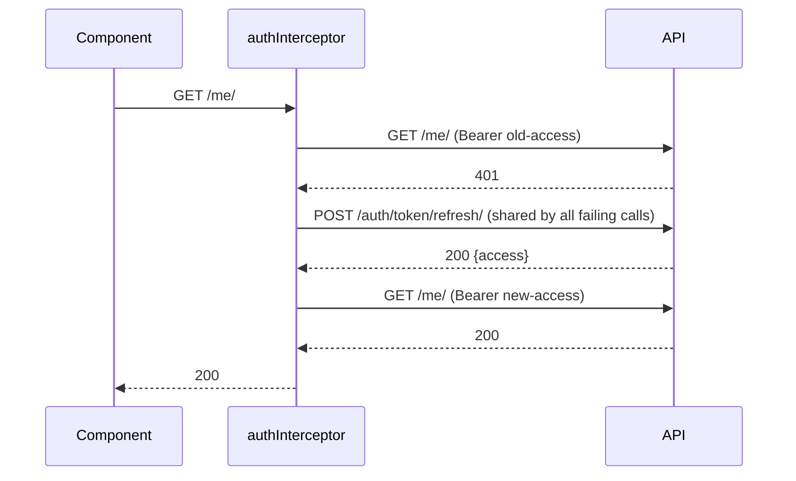

# 3. Frontend (Angular 21 + PrimeNG 21)

Paths are relative to `frontend/src/`. Every section maps the idea to Vue 3 where that helps.

**Contents:** [Modern Angular in this project](#31-modern-angular-in-one-page) · [Bootstrapping](#32-bootstrapping-appconfigts) · [Routing](#33-routing-and-lazy-loading) · [Guards](#34-guards) · [Auth](#35-authservice-and-the-session) · [Interceptors](#36-interceptors) · [Services](#37-services-and-models) · [Signals vs RxJS](#38-signals-vs-rxjs) · [Forms](#39-reactive-forms-and-server-errors) · [Error handling](#310-error-handling-strategy) · [PrimeNG](#311-primeng) · [Shared building blocks](#312-shared-building-blocks) · [Pages walkthrough](#313-pages-walkthrough) · [Layout and accessibility](#314-layout-titles-and-accessibility) · [Environments and build](#315-environments-build-and-budgets)

---

## 3.1 Modern Angular in one page

This project uses only current Angular style. If you read older tutorials, translate like this:

| Older style | This project | Vue 3 equivalent |
|---|---|---|
| `NgModule` declaring components | **standalone** components with `imports: [...]` | local component registration in an SFC |
| `constructor(private http: HttpClient)` | `private readonly http = inject(HttpClient)` | `const x = useX()` |
| `@Input() status` | `status = input.required<RequestStatus>()` (a signal) | `defineProps` |
| `@Output() save = new EventEmitter()` | `save = output<string>()` | `defineEmits` |
| two-way `@Input` + `@Output` pair | `visible = model(false)` | `defineModel` |
| `*ngIf`, `*ngFor` | `@if`, `@for (x of list; track x.id) {} @empty {}` | `v-if`, `v-for` |
| class-based `CanActivate` / interceptors | **functional** `CanActivateFn`, `HttpInterceptorFn` | router guards, axios interceptors |
| `zone.js` change detection | **zoneless** (signals and events trigger rendering) | Vue reactivity |

CLI 21 file names drop the type suffix: `login.ts` (class `Login`), not `login.component.ts`. Services and guards in this repo keep explicit suffixes (`auth.service.ts`, `auth.guard.ts`) for readability; the CLI-generated pipes are `relative-date-pipe.ts`, `file-size-pipe.ts`.

## 3.2 Bootstrapping (`app.config.ts`)

`main.ts` calls `bootstrapApplication(App, appConfig)`. Everything app-wide is a provider in `app/app.config.ts`:

```ts
providers: [
  provideBrowserGlobalErrorListeners(),
  provideRouter(routes),
  provideHttpClient(withInterceptors([errorInterceptor, authInterceptor])),
  { provide: TitleStrategy, useClass: AppTitleStrategy },
  providePrimeNG({ theme: { preset: Aura, options: { darkModeSelector: '.app-dark' } } }),
  MessageService,        // toasts, one instance for the whole app
  ConfirmationService,   // confirm dialogs, one instance for the whole app
  provideAppInitializer(() => firstValueFrom(inject(AuthService).restoreSession())),
]
```

- **Interceptor order matters:** the first one is the outermost. `errorInterceptor` wraps `authInterceptor`, so it only sees errors that survive the 401 refresh-and-retry.
- **`provideAppInitializer`** runs before the first navigation. If a token is stored, it loads `/me/` first, so after a page reload the guard already knows who is logged in (no flicker to `/login`).
- `app.html` renders `<p-toast />`, `<p-confirmdialog />`, and `<router-outlet />` once; every component uses them through the two services.

> **Vue:** `createApp(App).use(router).use(PrimeVue, {...}).mount()`, with an `await auth.fetchMe()` before mount.

## 3.3 Routing and lazy loading

**Where:** `app/app.routes.ts`, `features/requests/routes.ts`, `features/admin/routes.ts`.

```
/login                       Login                (public)
/                            MainLayout           canActivate + canActivateChild: authGuard
├── dashboard                Dashboard            loadComponent
├── requests                 REQUESTS_ROUTES      loadChildren
│   ├── ''                   RequestList
│   ├── new                  RequestForm
│   ├── :id                  RequestDetail
│   └── :id/edit             RequestForm
├── admin                    ADMIN_ROUTES         loadChildren, canActivate: roleGuard, data.roles ['admin']
│   ├── users | departments | categories
└── **                       NotFound
```

- `loadComponent` / `loadChildren` with dynamic `import()` put each page in its own JavaScript chunk, downloaded on first visit (the build output lists them as "Lazy chunk files").
- Order matters: `new` is declared before `:id`, otherwise "new" would be read as an id.
- `canActivateChild` re-runs the auth guard on every child navigation, not only when entering the layout.
- Every route has a `title`; `AppTitleStrategy` turns it into "Requests · Request Tracker".
- Pages read route parameters with `inject(ActivatedRoute).snapshot.paramMap.get('id')` and query parameters with `queryParamMap` (the request list reads `?status=`, `?preset=needs_review`, `?needs_my_action=true`, which is how dashboard cards deep-link into filtered lists).

> **Vue Router:** the same tree with `component: () => import('./X.vue')` and `meta: { roles: ['admin'] }`.

## 3.4 Guards

**Where:** `core/guards/auth.guard.ts`, `core/guards/role.guard.ts`.

```ts
// condensed from core/guards/auth.guard.ts
export const authGuard: CanActivateFn = (_route, state) =>
  inject(AuthService).isLoggedIn()
    ? true
    : inject(Router).createUrlTree(['/login'], { queryParams: { returnUrl: state.url } });
```

- Guards are plain functions. Returning a `UrlTree` redirects.
- `authGuard` remembers where you were going (`returnUrl`); the login page navigates there after success.
- `roleGuard` reads allowed roles from the route's `data.roles`, shows a "You do not have access" toast, and redirects to `/dashboard`.
- Guards only improve the UX. The API enforces every rule anyway (a staff token on `/api/v1/users/` gets 403).

## 3.5 AuthService and the session

**Where:** `core/auth/auth.service.ts`.

State is a **signal** holding the current user; everything else is derived:

```ts
private readonly user = signal<User | null>(null);
readonly currentUser = this.user.asReadonly();
readonly isLoggedIn = computed(() => this.user() !== null);
```

| Method | Does |
|---|---|
| `login(username, password)` | `POST /auth/token/` → store tokens → `loadMe()` |
| `loadMe()` | `GET /me/` → set the signal |
| `refresh()` | `POST /auth/token/refresh/` with the refresh token → store the new access token |
| `restoreSession()` | at startup: if a token exists, `loadMe()`; never fails |
| `logout()` | clear tokens and the signal, go to `/login` |

Tokens are stored in `localStorage` (`rt_access`, `rt_refresh`). The file has a TODO: production should prefer httpOnly cookies (see [04-security.md](04-security.md)).

Components read the user with `inject(AuthService).currentUser()`; templates re-render automatically when it changes.

> **Vue/Pinia:** a store with `ref(user)` and `computed(() => !!user.value)`.

## 3.6 Interceptors

**Where:** `core/interceptors/auth.interceptor.ts`, `core/interceptors/error.interceptor.ts`.

**`authInterceptor`** (inner):
1. Only touches requests to `environment.apiUrl` (never leaks the token to other hosts).
2. Adds `Authorization: Bearer <access>`, except for `/auth/` endpoints.
3. On a 401 from a non-auth endpoint, calls `refresh()` once and retries the original request with the new token.
4. If several requests fail at the same time, they share **one** refresh call (`refreshOnce` keeps a shared observable with `shareReplay(1)`).
5. If the refresh fails (refresh token expired), it logs out.



**`errorInterceptor`** (outer) shows app-wide toasts for errors no page should handle one by one:

| Status | Toast |
|---|---|
| 0 (network) | "Cannot reach the server" |
| 403 | "You do not have access" + server message |
| 429 | "Too many attempts" + "Please wait N seconds…" |
| ≥ 500 | "Something went wrong" |

It rethrows the error so callers still see it, and suppresses an identical toast within 3 seconds (five parallel failures give one toast). A request can opt out:

```ts
this.http.get(url, { context: skipGlobalErrorToast() });   // shared/http/error-context.ts
```

> **Vue:** two axios response interceptors; the refresh one is the classic "queue requests while refreshing" pattern.

## 3.7 Services and models

**Where:** `features/*/services/*.service.ts`, `features/*/models/*.ts`, `shared/models/*.ts`.

- One service per API resource (`RequestsService`, `CommentsService`, `AttachmentsService`, `CategoriesService`, `DashboardService`, `UsersService`, `DepartmentsService`, `AdminCategoriesService`), all `@Injectable({ providedIn: 'root' })` singletons.
- Methods return typed `Observable<T>`; they never subscribe. The component decides when to subscribe and what to do with errors.
- Query parameters are built with `HttpParams` (`params.append('status', s)` for repeated values).
- Interfaces mirror the serializers: `RequestListItem`, `RequestDetail` (adds `available_actions`), `RequestWrite`, `StatusHistoryItem`, `Comment`, `Attachment`, `Paginated<T>`, `ApiError`, `AdminUser`, `DashboardSummary`. They are hand-written today; generating them from `openapi.yaml` is listed as a future improvement.
- Shared value lists live in `shared/models/request-status.model.ts`: status/priority labels, select options, the **status → severity** map (`REQUEST_STATUS_SEVERITY`) and colors (`SEVERITY_COLOR`) used by badges, dashboard cards, and bars.

Special cases:
- **Uploads with progress:** `AttachmentsService.upload()` sends `FormData` with `{ reportProgress: true, observe: 'events' }` and emits `UploadProgress` events, then the `Response`.
- **Downloads:** `download()` requests `responseType: 'blob'` so the interceptor can attach the token (a plain `<a href>` cannot). The component turns the Blob into an object URL and clicks a temporary `<a download="original name">`. Error bodies then arrive as Blobs too; `blobApiErrorMessage()` reads them.

## 3.8 Signals vs RxJS

Both are used, each where it fits:

| Use | Tool | Example |
|---|---|---|
| Component state that templates read | `signal`, `computed` | `loading`, `items`, `canEdit = computed(...)` |
| Inputs from a parent | `input()`, `model()` | `StatusBadge.status`, `NameDialog.visible` |
| Side effect when a signal changes | `effect()` | `RequestAttachments` reloads when `request().status` changes |
| HTTP calls | `Observable` from `HttpClient` | every service method |
| Debounce, cancel stale requests | RxJS operators | list pages: `searchInput$.pipe(debounceTime(300), distinctUntilChanged())`, `reload$.pipe(switchMap(...))` |
| Observable → signal | `toSignal` | the comment character counter |
| Parallel calls | `forkJoin` | detail page loads request + history together |
| Sequential uploads | `from(files).pipe(concatMap(...))` | attachments, one file at a time |

The list pages use a small, reusable pattern:

```ts
private readonly reload$ = new Subject<void>();

this.reload$.pipe(
  map(() => this.currentQuery()),        // read the current filter signals
  tap(() => this.loading.set(true)),
  switchMap((q) => this.service.list(q).pipe(catchError(...))),   // cancels the previous call
  takeUntilDestroyed(this.destroyRef),
).subscribe((page) => { this.items.set(page.results); this.total.set(page.count); ... });
```

Any filter change, page change, or sort change just calls `reload$.next()`.

> **Vue:** signals ≈ `ref`/`computed`/`watchEffect`; the `reload$` pattern ≈ a `watch` on filters that aborts the previous fetch with an `AbortController`.

## 3.9 Reactive forms and server errors

**Where:** `features/requests/pages/request-form`, `features/admin/pages/users`, `features/requests/components/request-comments`, `shared/utils/api-errors.ts`.

- Forms are built in TypeScript with `NonNullableFormBuilder` (values are never `null` after `reset()`), typed controls, and validators (`required`, `maxLength`, `pattern(/\S/)` for "not only spaces", `email`). Cross-field rules are group validators (`reviewerNeedsDepartment`, `passwordsMatch` in the users page).
- Messages show when `control.invalid && control.touched`; submit calls `markAllAsTouched()` first.
- **Server field errors:** `applyServerErrors(form, error)` puts each `errors.<field>` message on the matching control as `{ server: message }` and returns anything left over for a toast. Templates show `control.getError('server')`.
- **Read-only mode:** the request form loads the request; if it is not your draft it sets `readOnlyReason`, calls `form.disable()`, and hides Save.

**Pitfall (real bug we hit):** `(ngSubmit)` only fires when the `<form>` has a form directive (`[formGroup]` with ReactiveFormsModule). A `<form>` around a lone `[formControl]` does a **native submit and reloads the page**. Wrap controls in a `FormGroup` (see `RequestComments.form`), or handle `(submit)` and call `preventDefault()` (see `NameDialog`).

> **Vue:** like VeeValidate's `useForm` + schema; `applyServerErrors` ≈ `setErrors(response.errors)`. In Laravel terms it is the `$errors` bag shown with `@error('title')`.

## 3.10 Error handling strategy

Three layers, so each error is shown exactly once:

1. **Global** (`errorInterceptor`): network errors, 403, 429, 5xx.
2. **Page** (`notifyError(messages, summary, error, detail?)` in `shared/utils/notify.ts`): everything else a page cares about (400 rule errors, 404). It **skips** statuses the interceptor already toasted.
3. **Form fields** (`applyServerErrors`): 400 field errors next to inputs.

`apiErrorMessage(error)` builds a readable message from `{detail, errors}`, appending field messages that differ from the detail ("This request is not ready to submit. Description: This field may not be blank.").

Pages with a full-page state (dashboard, request detail, admin lists) show an error card with a **Try again** button instead of only a toast.

## 3.11 PrimeNG

**Where:** `app.config.ts` (theme), every component's `imports`.

- **Version match:** PrimeNG's major version must match Angular's (21 ↔ 21) and `@primeuix/themes` must match PrimeNG (themes 2.x ↔ PrimeNG 21). `primeng@latest` targeted Angular 22 when this was set up; check peer dependencies before upgrading.
- **Theme:** `providePrimeNG({ theme: { preset: Aura, options: { darkModeSelector: '.app-dark' } } })`. Styles are injected at runtime as CSS variables (`--p-primary-color`, `--p-surface-50`, ...), which our SCSS reuses. Without `darkModeSelector`, Aura follows the OS dark mode and you get dark components on a light page.
- **No animations provider:** PrimeNG 21 uses CSS animations, so `provideAnimationsAsync()` is not needed.
- **Import components individually:** `imports: [Button, Card, Select, ...]`. Exception: **`Table` is not standalone in v21**, so import `TableModule`.
- **Templates are named `ng-template`s:** `<ng-template #header>`, `#body let-item`, `#emptymessage`, `#footer`, `#start` / `#end` (Toolbar), `#content` (Timeline).
- **Pass-through (`pt`)** customizes internal elements without CSS hacks: `[pt]="{ eventOpposite: { style: { display: 'none' } } }"` removes the Timeline's empty left column.
- **Typed templates:** `let-item` is `any`, and strict templates refuse `map[item.x]`; call a typed method instead (`priorityLabel(item.priority)`).
- **Before using a component API, check the installed version:** the type definitions in `node_modules/primeng/types/primeng-<component>.d.ts` list every input, output, and template name.

Components used and where:

| Component | Used for |
|---|---|
| Card, Toolbar, Drawer | page panels, top bar, tablet menu |
| Table (lazy) | request list, users (server-side paging and sorting) |
| Select, SelectButton, IconField + InputText | filters, form selects, "Needs review" preset |
| InputText, Password, Textarea, ToggleSwitch | forms |
| Button (`[loading]`), Tag, Message | actions, badges, inline errors |
| Toast, ConfirmDialog, Dialog | notifications, confirmations, reject remarks / admin forms |
| Timeline | status history |
| FileUpload (basic, auto, `customUpload`), ProgressBar | uploads with real progress; dashboard bars |
| Skeleton | loading placeholders |

**FileUpload pattern:** `mode="basic" [auto]="true" [customUpload]="true" (uploadHandler)="onFilesPicked($event, uploader)"` hands over the picked files immediately; our code validates and uploads them with `HttpClient`, then calls `uploader.clear()`. `accept=` is left off on purpose: in basic mode PrimeNG silently drops invalid files, and we want an explicit toast for each.

## 3.12 Shared building blocks

**Where:** `shared/`.

| Piece | Purpose |
|---|---|
| `components/status-badge` | the one place that decides how a status looks |
| `components/empty-state` | icon + title + message + projected action button |
| `components/table-skeleton` | placeholder rows while a list loads for the first time |
| `components/page-header` | title, subtitle, projected action buttons |
| `pipes/relative-date-pipe` | "just now", "3 hours ago" for 7 days, then a date (`Intl.RelativeTimeFormat`, no library) |
| `pipes/file-size-pipe` | 1536 → "1.5 KB" |
| `constants/attachments.ts` | upload limits mirrored from the backend settings + `validateAttachment()` |
| `utils/api-errors.ts` | `apiErrorMessage`, `applyServerErrors`, `blobApiErrorMessage` |
| `utils/notify.ts` | `notifyError` (page-level toasts without duplicating global ones) |
| `http/error-context.ts` | `skipGlobalErrorToast()`, `isGloballyHandled()` |
| `models/*` | `Paginated<T>`, `ApiError`, `User`, `Category`, status/priority types and maps |

Inside a feature, small reusable pieces go in `features/<feature>/components/` (for example the admin `NameDialog` used by departments and categories).

## 3.13 Pages walkthrough

| Page | Key ideas to study |
|---|---|
| `features/auth/login` | reactive form, `loading` signal, 401 handled locally, 429 by the interceptor, `returnUrl` |
| `features/dashboard` | role-aware wording, skeleton / error / empty states, cards that deep-link with `queryParams`, progress bars colored from the shared map |
| `features/requests/pages/request-list` | lazy `p-table`, `reload$` + `switchMap`, debounced search, URL filters, presets, owner-only actions, ConfirmDialog delete |
| `features/requests/pages/request-form` | create and edit in one component, read-only mode, server field errors |
| `features/requests/pages/request-detail` | buttons driven by `available_actions`, ConfirmDialog vs reject Dialog, `forkJoin`, Timeline, not-found and error states |
| `features/requests/components/request-comments` | `FormGroup` + `ngSubmit`, character counter with `toSignal`, `can_delete` |
| `features/requests/components/request-attachments` | client checks, sequential uploads with progress, Blob download, `effect()` reload on status change |
| `features/admin/pages/users` | lazy table with four filters, create/edit dialog, group validators, reset-password dialog, activate/deactivate |
| `features/admin/pages/departments`, `categories` | simple lists, shared `NameDialog`, server messages when delete is blocked, ToggleSwitch |

## 3.14 Layout, titles, and accessibility

**Where:** `layouts/main-layout`, `core/title-strategy.ts`, `styles.scss`.

- The toolbar shows Dashboard and Requests for everyone, plus Users / Departments / Categories for admins (`adminNav` computed from the role).
- At ≤ 960 px the links move into a `p-drawer` opened by a hamburger button; the drawer closes after navigation.
- A "Skip to content" link appears on the first Tab and jumps to `<main id="main-content">`.
- Every form control has a `<label for>` (or `ariaLabel` on PrimeNG filters and icon buttons); icon-only buttons always have an `ariaLabel`; the admin tables mark headers with `scope="col"`.
- Dialogs are modal and focus their first field when opened; Escape closes them.
- Links get a visible focus outline (`a:focus-visible` in `styles.scss`).

## 3.15 Environments, build, and budgets

- `environments/environment.development.ts` (used by `ng serve`) → `apiUrl: 'http://localhost:8000/api/v1'`; `environment.ts` (production build) → `'/api/v1'` for a same-domain deployment. Angular swaps them through `fileReplacements` in `angular.json`.
- `ng build` warns above the **initial bundle budget** (750 kB warning, 1 MB error in `angular.json`). Current initial size is about 696 kB; pages are lazy chunks.
- `ng test` runs Vitest (the one root spec checks the app boots with its providers).
- The dev server (Vite) re-optimizes dependencies the first time a new PrimeNG module is imported and reloads the page once; if a page ever looks stale, save a file or restart `ng serve` (see [07-troubleshooting.md](07-troubleshooting.md)).
